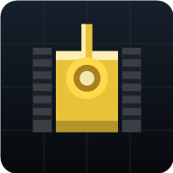

# 坦克大战 · Tank Battle

经典《坦克大战》风格的闯关小游戏，纯 HTML5 Canvas 实现（无任何图片/音频素材依赖，图形与音效全部程序化生成），通过 **Capacitor** 打包为 Android APK。



## 玩法

- 守住屏幕底部的**老鹰基地**，消灭本关全部敌方坦克即过关。
- **移动**：左半屏任意位置按下拖动出现虚拟摇杆（自动跟随手指）；桌面端用 `WASD` / 方向键。
- **射击**：右下角「开火」按钮，或直接点按右半屏；桌面端用 `空格` / `J`。
- **暂停**：右上角按钮，或按 `P` / `Esc`。
- 敌人分 4 种：普通（灰）、快速（蓝）、火力（绿，双发快弹）、装甲（橙，需 4 发）。
- 击毁**身上闪红灯**的敌方坦克会掉落道具：
  | 图标 | 效果 |
  | --- | --- |
  | ★ | 弹药升级（最多 3 级：穿甲 / 双发 / 破钢墙） |
  | ♥ | 9 秒无敌护盾 |
  | ✹ | 全屏轰炸，秒杀场上所有敌人 |
  | ⏱ | 冻结所有敌人 7 秒 |
  | ⛏ | 基地周围临时变成钢墙 16 秒 |
  | ♜ | 额外一条命 |

地图元素：砖墙（可打碎）、钢墙（满级炮弹可破）、草丛（可通行、遮挡坦克）、河流（不可通行、子弹可穿过）。

## 目录结构

```
tank-battle/
├─ www/                     # 前端（打包时原样拷进 APK）
│  ├─ index.html
│  ├─ css/style.css
│  ├─ js/audio.js           # WebAudio 合成音效
│  ├─ js/maps.js            # 关卡地图（13x13 字符网格）
│  ├─ js/game.js            # 游戏内核
│  ├─ manifest.webmanifest  # PWA 清单
│  ├─ sw.js                 # 离线缓存（仅浏览器环境生效）
│  └─ icon.svg / icon-192.png / icon-512.png
├─ assets/                  # @capacitor/assets 的输入（1024 图标 + 2732 启动图）
├─ tools/make-icons.ps1     # 重新生成 PWA 图标（192/512）
├─ tools/make-android-assets.ps1  # 重新生成安卓图标/启动图
├─ package.json
├─ capacitor.config.json
└─ .github/workflows/android.yml   # 云端一键出 APK
```

## 一、先在电脑上试玩

无需任何安装，**直接双击 `www/index.html`** 就能玩。

或者起一个本地服务器（便于手机同局域网访问）：

```powershell
cd tank-battle
npx --yes http-server www -p 5173 -c-1 -o
```

## 二、打包成 APK

### 方式 A：本机打包（需要 Node + JDK17 + Android SDK）

> 这一步依赖比较重（约 1GB），且 winget 安装 JDK / SDK 会弹 UAC 提权窗口，
> **需要你本人在 PowerShell（管理员）里执行**。

```powershell
# 1) 装工具链（管理员 PowerShell）
winget install OpenJS.NodeJS.LTS
winget install EclipseAdoptium.Temurin.17.JDK
winget install Google.AndroidStudio     # 装完打开一次，按向导装 Android SDK 34
```

装完**新开一个** PowerShell：

```powershell
# 2) 让命令行找到 JDK / SDK
$env:JAVA_HOME = "C:\Program Files\Eclipse Adoptium\jdk-17*"
$env:ANDROID_HOME = "$env:LOCALAPPDATA\Android\Sdk"
$env:Path += ";$env:ANDROID_HOME\platform-tools;$env:ANDROID_HOME\cmdline-tools\latest\bin"

# 3) 安装 npm 依赖并生成 android 工程
cd tank-battle
npm install
npx cap add android
npx cap sync android

# 4) 出包
cd android
.\gradlew.bat assembleDebug
```

产物：`tank-battle/android/app/build/outputs/apk/debug/app-debug.apk`

传到手机上点击安装即可（需允许「安装未知来源应用」）。

用 USB 直接装到手机：

```powershell
adb install -r app\build\outputs\apk\debug\app-debug.apk
```

### 方式 B：GitHub Actions 云端打包（本机零安装）

1. 把 **`tank-battle` 目录本身作为仓库根目录**推到 GitHub（`.github/workflows/android.yml` 已在其中）。
2. 打开仓库的 **Actions** 页 → 选择 **Build Android APK** → **Run workflow**。
3. 跑完后在该次运行的 **Artifacts** 里下载 `tank-battle-apk`，解压得到 `app-debug.apk`。

> 工作流做了这些事：装 Node20 + JDK17 + Android SDK34 → `npm install` → `cap add android`
> → 用 `@capacitor/assets` 生成桌面图标 → `gradlew assembleDebug` → 上传 APK。
> 首次运行约 4~6 分钟。APK 是 **debug 包**，可以直接安装，但体积较大、未做混淆；
> 要上架应用商店需要自行配置 keystore 后打 release 包。
>
> ⚠️ 用网页「Upload files」拖拽上传时，**以 `.` 开头的 `.github` 文件夹常被浏览器忽略**，
> 上传后请到仓库页面用 *Add file → Create new file*，文件名填
> `.github/workflows/android.yml`，再把本地这个文件的内容粘进去。

### 方式 C：不装 APK，直接当网页 App 用（最快）

把 `tank-battle/www` 整个目录放到任意静态托管（或本机起 `http-server`），
手机浏览器打开 → 菜单「添加到主屏幕」→ 就是一个全屏、可离线运行的 App。

## 三、个性化修改

| 想改什么 | 改哪里 |
| --- | --- |
| 应用名 | `capacitor.config.json` 的 `appName`（改完 `npx cap sync`） |
| 包名 | `capacitor.config.json` 的 `appId`，**必须在 `cap add android` 之前改** |
| 桌面图标 | 替换 `android/app/src/main/res/mipmap-*/ic_launcher*.png`，或装 `@capacitor/assets` 后放 `assets/icon.png` 再 `npx capacitor-assets generate` |
| 关卡地图 | `www/js/maps.js`（13×13 字符网格，`#`砖 `@`钢 `*`草 `~`水 `B`基地） |
| 难度 | `www/js/game.js` 里 `stageConfig()`（敌人总数、同屏上限、类型概率） |
| 玩家手感 | `www/js/game.js` 里 `spawnPlayer()` 的 `speed` / `fireDelay` |
| 锁定横屏 | `android/app/src/main/AndroidManifest.xml` 的 `<activity>` 加 `android:screenOrientation="sensorLandscape"` |

## 四、已知说明

- 音效首次触发需要一次用户交互（浏览器/WebView 策略），点击开始即已解锁。
- 游戏为正方形画布，横屏竖屏都能玩；竖屏可视面积略大。
- `sw.js` 离线缓存只在 http(s) 环境注册，Capacitor（`https://localhost`）下会自动跳过，避免缓存旧版本。
